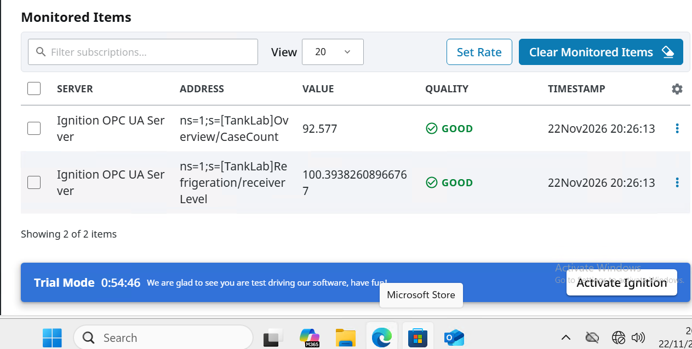
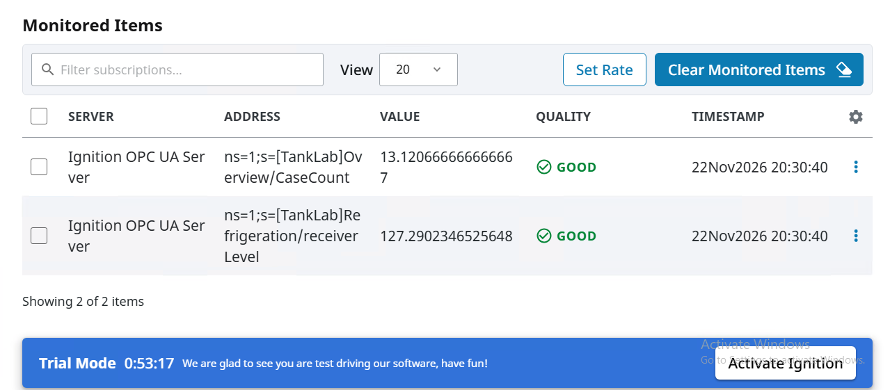

# Ignition simulator observation — 22 November 2026

Yassar Sambo performed this exercise in the existing Hyper-V training lab, using Christopher Di-Nozzi's publicly available OT lab series as a learning reference. The record combines captured Quick Client displays with the lab owner's confirmation of the device state for each image.

## Observation

The owner identified the first image as taken while TankLab was disabled and the second as taken after it was enabled again. Each image shows a numeric receiver level and GOOD quality. The later image has a different value and a later displayed timestamp.

| Owner-reported device state | receiverLevel, rounded | Displayed quality | Displayed data timestamp |
| --- | ---: | --- | --- |
| Disabled | 100.394 | GOOD | 22Nov2026 20:26:13 |
| Enabled again | 127.290 | GOOD | 22Nov2026 20:30:40 |

Values are raw simulator outputs. Engineering units and calibration are unrecorded. GOOD reproduces the UI label, with the underlying OPC UA StatusCode still to be captured. The table reproduces the Quick Client Timestamp column. Identifying that column as a source timestamp or a server timestamp requires a separate check. Timezone and clock alignment also require verification.

Both images additionally show Overview/CaseCount, approximately 92.577 and 13.121 respectively, with GOOD quality and the same timestamps as the corresponding receiverLevel sample.

## Evidence

The lab owner supplied the following state clarification with the latest pair.

> The first screenshot is when it is disabled and the second is when it is enabled.

### Image identified by the owner as disabled

Original filename `Screenshot 2026-11-22 202916.png`. Original size 142,691 bytes. SHA-256 `14f89b6dbf48df18f54cd0c1842317daf29ac1b278e2bb004091be6bcac2ad59`.

### Image identified by the owner as enabled again

Original filename `Screenshot 2026-11-22 203047.png`. Original size 111,412 bytes. SHA-256 `5c0536490a1b80f64c20bc834a7f6142d9c015937176a4001eee94df18f1fbbc`.

The image copies preserve the supplied bytes under descriptive filenames, with byte counts and SHA-256 hashes recorded for traceability. Device-state attribution comes from the owner's statement. The captured image area shows the monitored data table. Direct evidence of the Enabled setting and precise change times remains a follow-up item.

## Setup and procedure provenance

- Windows 11 VM `CLIENT01` in the existing Hyper-V lab.
- Ignition Standard 8.3.10, build `b2026100610`, viewed through the VM browser at `localhost:8088`.
- Programmable Device Simulator connection named `TankLab`.
- The guided setup specified the Dairy program, Repeat Program on, a 1000 ms Base Rate and Legacy Mode off. The browsed Overview and Refrigeration folders match the documented Dairy structure. A saved-configuration check remains part of reproduction.
- Quick Client subscribed to `ns=1;s=[TankLab]Refrigeration/receiverLevel` and `ns=1;s=[TankLab]Overview/CaseCount`, as displayed in the supplied evidence.
- The guided test specified changing the simulator connection's Enabled setting, saving each change in a second browser tab while retaining Quick Client in the first. The owner's confirmation establishes the image-state labels. The precise action times, saved settings and foreground/background tab state still require capture.

This extends the lab with an embedded OPC UA server/client observation. Inter-zone industrial protocol testing through OPNsense remains a separate experimental task.

## Interpretation and evidence boundary

The supported observation is GOOD displayed at a moment the owner identified as disabled, followed by another GOOD sample with a different value and a later timestamp after reported re-enablement. Follow-up diagnostics should distinguish a retained display, retained server or driver data, continuing data updates and browser notification or rendering behaviour. Establishing whether updates stopped, and identifying the component handling each transition, requires continuous observations, read responses and diagnostic logs.

OPC UA represents status and timestamps as distinct fields in a DataValue. A source timestamp may mark the most recent change in the value or status. A stable value may therefore legitimately retain an older source timestamp under change-based reporting. Any freshness rule should reflect the expected update mechanism, source availability and clock behaviour for the particular signal. [OPC Foundation, Part 4, DataValue](https://reference.opcfoundation.org/specs/OPC-10000-4/7.11)

The evidence consists of an owner-performed exercise, two point-in-time displays and the owner's state labels. Continuous freeze behaviour, transition latency, exact outage duration, notification handling and independent reproduction remain unresolved. Measuring any outage or detection delay requires action times alongside the sample timestamps. The raw OPC UA StatusCode, both timestamp fields, subscription settings and diagnostic logs would strengthen the record.

The exercise supports practical learning about data quality, freshness and availability. Novelty, a reproducible product defect, operational effectiveness and commercial demand each require additional evidence.

## Reproduction questions

1. Record device configuration, trial timer state, Quick Client subscription rate, browser version and foreground/background tab behaviour before another run.
2. Capture a baseline showing two updates of the same signal and the current VM clock.
3. Record the actual disable action and the device list showing Enabled false. Capture the unchanged or changed display over a known interval.
4. While disabled, compare the existing subscription with Quick Client's single Read action and, if available, a second OPC UA client. Record raw status, source and server timestamps, and the read request's cache policy before interpreting the responses.
5. Re-enable the simulator, record the action time and capture resumed updates.
6. Repeat with the same settings and compare simulator, OPC UA and browser diagnostics to establish where values and status are generated, retained or updated.

A full evaluation should also distinguish a legitimately steady signal from a disrupted update path.

## Relation to OT-RRDE research

The packaging-line pilot cases PILOT-35 and PILOT-64 describe an operator-station outage alongside continuing local protective functions. This exercise prompts questions about how an operator identifies stale information, what alternative visibility remains, the expected time to restore it and the operational consequence of losing it. The simulated readings provide a learning example. Scoring mission and safety impact for those fictional dossiers still requires their own documented facts and independent judgement. [Frozen OT-RRDE pilot packet](https://github.com/yassarsambo/ot-risk-remediation-decision-engine/blob/48f4fd3fa535f7d5433a656463f684ac80aac35c/docs/v0.3-reviewer-pilot.md)

## References

- [Christopher Di-Nozzi, Designing the OT Security Lab](https://cdino.net/blog/2026/ot-lab-design/)
- [Christopher Di-Nozzi, Building a SCADA System and Historian](https://cdino.net/blog/2026/ot-lab-build-scada-historian/)
- [Inductive Automation, Programmable Device Simulator](https://docs.inductiveautomation.com/docs/8.3/ignition-modules/opc-ua/opc-ua-drivers/programmable-device-simulator)
- [Inductive Automation, OPC Quick Client](https://docs.inductiveautomation.com/docs/8.3/ignition-modules/opc-ua#opc-quick-client)
- [OPC Foundation, DataValue](https://reference.opcfoundation.org/specs/OPC-10000-4/7.11)
